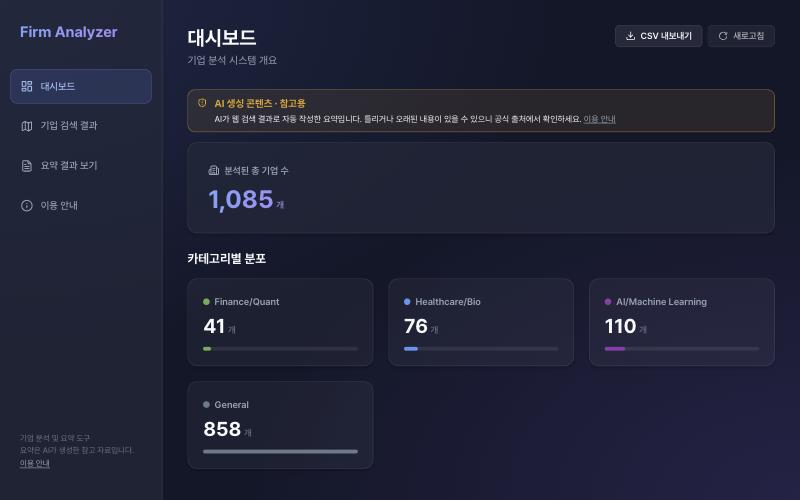
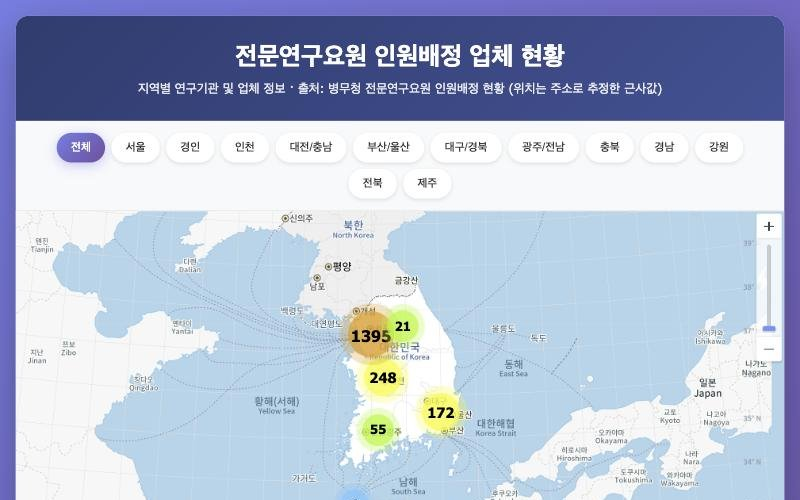
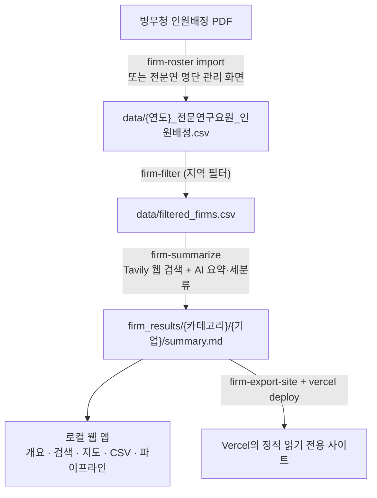

<div align="center">

# Firm Analyzer

**전문연구요원 지정업체 분석 도구**

병무청 전문연구요원 인원배정 명단의 기업을 웹에서 검색하고,
AI가 요약·분류해 한눈에 보여 주는 도구입니다.

[English](README.md) · **한국어**

[](https://firm-analyzer.vercel.app)


[](LICENSE)

**[라이브 데모 바로 가기 →](https://firm-analyzer.vercel.app)**

</div>

> [!WARNING]
> **AI 생성 콘텐츠 · 참고용** — 기업 요약과 분류는 공개 웹 검색 결과를 바탕으로 AI가
> 자동 생성한 참고 자료입니다. 사실과 다르거나 오래된 정보, 이름이 비슷한 다른 기업의
> 정보가 섞여 있을 수 있으며 해당 기업의 공식 입장이나 평가가 아닙니다. 중요한 결정 전에는
> 반드시 기업의 공식 채널과 병무청에서 직접 확인하세요. 전체 내용은
> [DISCLAIMER.md](DISCLAIMER.md)를 참고하세요.

<p align="center">
  
  
</p>

## 목차

- [라이브 데모](#라이브-데모)
- [동작 방식](#동작-방식)
- [빠른 시작](#빠른-시작)
- [직접 배포하기](#직접-배포하기)
- [전문연 명단 업데이트](#전문연-명단-업데이트)
- [파이프라인 실행](#파이프라인-실행)
- [설정](#설정)
- [참고: 명령어와 API](#참고-명령어와-api)
- [데이터와 개인정보](#데이터와-개인정보)
- [문서](#문서)
- [개발](#개발) · [라이선스](#라이선스)

## 라이브 데모

**<https://firm-analyzer.vercel.app>** 는 이 저장소의 코드로 만든 읽기 전용 뷰어로,
Vercel에서 호스팅됩니다. 설치나 로그인 없이 바로 사용할 수 있습니다.

| | |
|---|---|
| **상태** | [](https://firm-analyzer.vercel.app) |
| **공개된 데이터** | 기업 1,085곳(대부분 서울 소재)의 AI 요약, 인원배정 명단 전체 기업의 지도 |
| **마지막 배포** | 2026-11-14 |
| **업데이트 방식** | `main`에 병합된 코드는 자동으로 배포됩니다. 새 데이터는 관리자 PC에서 만들어 스냅샷으로 올리며, 올리면 배포도 시작됩니다([직접 배포하기](#직접-배포하기) 참고). |

### 사이트 사용법

| 화면 | 할 수 있는 일 |
|------|---------------|
| **개요** (`/`) | 요약된 기업이 분야별로 어떻게 나뉘는지, 인원배정 명단이 관할 지방병무청별로 어떻게 퍼져 있는지 봅니다. 각 줄을 누르면 해당 분야나 지역으로 이동합니다. **CSV 내려받기**로 요약된 전체 기업을 CSV 한 파일로 받을 수 있습니다. |
| **배정 지도** (`/firms`) | 인원배정 명단 전체를 지도에서 보고, 지역별로 거르거나 업체명·주소로 검색합니다. 위치는 주소로 추정한 근사값입니다. |
| **업체 요약** (`/summary`) | 기업 이름과 요약 내용을 검색하고(어느 화면에서든 `/` 키) 카테고리·산업 섹터·기술 버티컬로 좁힌 뒤, 기업을 눌러 요약과 근거 출처를 읽습니다. 검색어는 목록과 요약에 형광펜으로 표시되고, **지도에서 보기**로 해당 기업을 지도에서 엽니다. |
| **이용 안내** (`/about`) | AI가 작성한 내용의 성격과 한계, 정정·삭제 요청 방법을 안내합니다. |

검색 조건은 URL에 남기 때문에 즐겨찾기하거나 공유할 수 있습니다. 예:
[`/summary?q=반도체`](https://firm-analyzer.vercel.app/summary?q=%EB%B0%98%EB%8F%84%EC%B2%B4),
[`/summary?category=ai_ml`](https://firm-analyzer.vercel.app/summary?category=ai_ml).

파일을 바꾸거나 API 사용량을 쓰는 화면(**전문연 명단 관리**, **파이프라인 실행**,
**설정 변경**)은 호스팅된 사이트에 없습니다. 이 기능들은 [로컬 앱](#빠른-시작)의
**관리** 메뉴에서만 동작합니다.

화면은 기본이 밝은 테마이고, 시스템이 다크 모드면 어두운 테마로 열립니다. 상단 바의
달/해 버튼으로 바꿀 수 있습니다.

> [!NOTE]
> 명단에 포함된 기업의 관계자로서 요약의 정정이나 삭제를 원하시면 이 저장소에 이슈를
> 남겨 주세요. 다음 배포에서 해당 기업을 제외합니다.

## 동작 방식



- **연도별 명단 업데이트.** 새 인원배정 PDF(또는 CSV)를 올리면 모든 행을 추출하고,
  행 수를 마지막 연번과 대조하며, 새로 들어온 기업과 빠진 기업을 보여 준 뒤 파이프라인
  입력을 새 명단으로 바꿉니다.
- **AI 선택.** OpenAI, Claude, Gemini, GitHub Models 중 하나를 고릅니다. 사용하는
  제공자의 키만 있으면 됩니다.
- **다축 세분류.** 산업 섹터, 기술 버티컬, 비즈니스 모델, 밸류체인 위치, 조직 유형을
  신뢰도와 근거 문장과 함께 분류합니다. 분류 체계는 [`taxonomy.yml`](taxonomy.yml)에
  데이터로 들어 있으며 [docs/segmentation.md](docs/segmentation.md)에 설명되어 있습니다.
- **추적 가능한 결과.** 모든 요약에 AI 생성 표시가 붙고, 근거가 된 검색 결과가 출처로
  나열됩니다.
- **백그라운드 작업.** 필터·요약·세분류가 별도 프로세스로 실행되며 실시간 로그,
  진행률, 취소 버튼을 제공합니다.
- **정적 사이트 배포.** 명령어 하나로 읽기 전용 뷰어를 스냅샷으로 만들어 서버 없이
  호스팅할 수 있습니다.

## 빠른 시작

Python 3.12 이상, [uv](https://docs.astral.sh/uv/), Node.js 22 이상이 필요합니다.

```bash
git clone https://github.com/<your-username>/firm_websearch.git   # 포크한 저장소 또는 이 저장소
cd firm_websearch
uv sync                                     # Python 의존성 설치
cp .env.example .env                        # 키 입력 (아래 참고)
cd frontend && npm ci && npm run build && cd ..
uv run firm-app                             # http://localhost:8001
```

`.env`에는 최소한 검색 키와 AI 제공자 한 곳의 키가 필요합니다.

```dotenv
TAVILY_API_KEY=...
LLM_PROVIDER=openai              # openai | claude | gemini | github
OPENAI_API_KEY=...               # 또는 ANTHROPIC_API_KEY / GEMINI_API_KEY
```

지도를 보려면 `KAKAO_JS_API_KEY`도 넣으세요. 모든 변수는
[`.env.example`](.env.example)에 설명되어 있습니다. `.env`와 `config.yml`은 Git에서
제외되어 있으니 절대 커밋하지 마세요.

> [!TIP]
> **프론트엔드를 수정할 때**는 터미널 하나에서 `uv run firm-app`을, 다른 터미널의
> `frontend/`에서 `npm run dev`를 실행한 뒤 <http://localhost:5173>을 여세요. 개발
> 서버가 `/api` 요청을 Flask로 넘겨 주므로 둘이 같은 출처에서 동작합니다.

> [!CAUTION]
> 서버는 `127.0.0.1`에만 바인딩됩니다. API에는 인증이 없고 API 사용량을 소모하는
> 작업을 시작할 수 있으므로, 신뢰할 수 있는 네트워크에서만 노출하세요(`FLASK_HOST`).
> 결과를 공개하려면 대신 정적 사이트로 배포하세요.

## 직접 배포하기

[라이브 데모](#라이브-데모)는 이 코드를 정적 사이트로 배포한 것입니다. 같은 방법으로
내 데이터를 담은 사이트를 직접 배포할 수 있습니다. Vercel은 파일만 제공하고, 요약은 모두
내 PC에서 만들어집니다. Kakao JavaScript 키를 제외한 어떤 API 키도 PC 밖으로 나가지
않습니다.

**준비물:** [Vercel](https://vercel.com/) 계정(무료 Hobby 플랜으로 충분),
[빠른 시작](#빠른-시작) 완료, [파이프라인](#파이프라인-실행)으로 만든 `firm_results/`의
요약.

```bash
# 1. 데이터 생성 (아직 안 했다면, TAVILY_API_KEY와 AI 키 하나 필요)
uv run firm-filter
uv run firm-summarize --limit 10            # 전체를 처리하려면 --limit 제거

# 2. 읽기 전용 뷰어를 frontend/static-site/에 스냅샷으로 저장 (Git 제외 폴더)
uv run firm-export-site

# 3. 최초 1회: 로그인 후 frontend 폴더를 새 Vercel 프로젝트에 연결
cd frontend
npx vercel login
npx vercel link
npx vercel pull --yes --environment=production

# 4. 배포할 때마다: 내 PC에서 빌드하고 결과만 업로드
npx vercel build --prod
npx vercel deploy --prebuilt --prod
```

GitHub에서 배포하려면 Vercel 토큰과 프로젝트 ID 두 개를 저장소 시크릿으로 한 번만
추가하세요. 그 뒤로는 `main`에 병합하면 배포되고, 새 데이터는
`scripts/publish_site_data.sh`로 올립니다. 스냅샷을 릴리스 파일로 올리고 배포까지
시작합니다. [자동 배포](docs/VERCEL_DEPLOY.ko.md#자동-배포)를 참고하세요.

배포가 끝나면 Vercel이 URL(`https://<프로젝트>.vercel.app`)을 알려 줍니다. 그 주소에서
지도가 뜨려면 `firm-export-site`를 실행할 때 `.env`에 `KAKAO_JS_API_KEY`가 있어야 하고,
Kakao 앱의 허용 도메인에 그 URL이 등록되어 있어야 합니다. 로컬 미리보기와 기업 삭제까지
포함한 전체 안내는 **[docs/VERCEL_DEPLOY.ko.md](docs/VERCEL_DEPLOY.ko.md)**
([English](docs/VERCEL_DEPLOY.md))에 있습니다.

> [!IMPORTANT]
> 배포하면 스냅샷에 담긴 모든 요약이 공개됩니다. AI 생성 표시를 유지하고, 기업이 정정을
> 요청할 수 있는 연락 수단을 마련하며, 요청이 오면 해당 기업을 삭제하세요.
> [DISCLAIMER.md](DISCLAIMER.md)의 '운영자의 책임'을 참고하세요.

<details>
<summary><b>왜 "Import Git Repository"나 Deploy 버튼을 쓰지 않나요?</b></summary>

`firm_results/`는 실제 기업에 대한 AI 작성 글과 수집한 웹 페이지를 담고 있어 커밋하지
않습니다. 그래서 Vercel 서버에서 빌드하면 데이터가 없는 빈 사이트가 됩니다. 이 때문에
[`frontend/vercel.json`](frontend/vercel.json)에서 Git 푸시 배포를 꺼 두었고, `vercel build`로
로컬에서 빌드한 뒤 `--prebuilt`로 업로드합니다.

다른 정적 호스팅도 쓸 수 있습니다. `frontend/`에서 `npm run build:static`을 실행하면
`frontend/dist/`에 일반 정적 사이트가 만들어집니다. `/summary` 같은 링크가 열리도록,
파일이 아닌 경로에는 `index.html`을 돌려주도록 설정하세요(`vercel.json`의 rewrite와 동일).

</details>

## 전문연 명단 업데이트

병무청은 매년 새 「전문연구요원 인원배정 현황」 PDF를 공개합니다.

**웹 화면에서:** **전문연 명단 관리**를 열고 PDF를 끌어다 놓은 뒤 연도를 확인하고
**가져오기**를 누르세요. 다음 결과를 얻습니다.

- 새 명단이 `data/<연도>_전문연구요원_인원배정.csv`로 저장되고, 원본 PDF가 옆에
  함께 보관됩니다.
- 행 수가 마지막 연번과 맞지 않으면 경고가 표시됩니다. 표 추출에서 행이 빠졌거나
  중복되었다는 뜻입니다.
- 이전 명단과의 비교(추가된 기업, 빠진 기업, 유지된 기업 수)를 보여 주며, 각각 CSV로
  받을 수 있습니다.
- 새 명단이 파이프라인 입력으로 지정됩니다(기존 명단을 유지하려면 옵션을 해제하세요).

그다음 **파이프라인 실행** 화면에서 **필터 후 요약**을 실행하세요. 이미 요약된 기업은
건너뛰므로 새 기업에 대해서만 API 비용이 듭니다.

PDF 추출은 기본적으로 표 인식(pdfplumber, 무료, 몇 초)을 사용합니다. 텍스트 레이어가
없는 스캔 PDF라면 **AI로 추출**을 선택하세요. 페이지를 선택한 AI 제공자에게 보냅니다.

**명령줄에서:**

```bash
uv run firm-roster import ~/Downloads/2027_전문연구요원_인원배정.pdf --year 2027
uv run firm-roster list                    # *가 현재 사용 중인 명단
uv run firm-roster compare 2026_전문연구요원_인원배정.csv 2027_전문연구요원_인원배정.csv --out-dir data/diff
uv run firm-roster activate 2026_전문연구요원_인원배정.csv   # 이전 명단으로 되돌리기
uv run firm-roster import list.csv --year 2027 --overwrite  # CSV (UTF-8 또는 CP949)
uv run firm-roster import scan.pdf --year 2027 --method llm --provider gemini
```

사용 중인 명단은 `config.yml`의 `data.roster`입니다. 비어 있으면 `data/`에서 가장 최신
연도의 `<연도>_전문연구요원_인원배정.csv`를 사용합니다. 연도 간 기업은 이름으로
대조하며, (주)/㈜/주식회사 같은 법인 표기와 띄어쓰기는 무시합니다. 따라서 연구소 이름이
바뀐 기업은 삭제 1건과 추가 1건으로 표시됩니다.

새 명단으로 지도를 갱신하려면 `uv run --env-file .env firm-geocode`로 지도 데이터를
다시 만드세요. `--env-file`이 중요합니다. 이 명령은 `KAKAO_REST_API_KEY`를 환경 변수에서만
읽기 때문에, 빠뜨리면 모든 기업이 지역 단위의 대략적인 좌표로 표시됩니다.
[docs/GEOCODING.md](docs/GEOCODING.md)를 참고하세요.

## 파이프라인 실행

**파이프라인 실행** 화면은 각 단계를 백그라운드 작업으로 실행합니다. 명령줄에서는
다음과 같이 실행합니다.

```bash
uv run firm-filter                                  # 사용 중인 명단 -> data/filtered_firms.csv
uv run firm-filter --locations 서울 경기            # config.yml의 지역 필터 대신 사용
uv run firm-summarize --dry-run                     # 검색 쿼리만 확인
uv run firm-summarize --limit 10                    # 10개 기업 검색·요약·세분류
uv run firm-summarize --provider claude --limit 10
uv run firm-segment --dry-run                       # 예전 요약에 세분류 추가
uv run firm-export                                  # 전체 기업 -> firm_results/firms_export.csv
```

실패한 기업(잘못된 모델 출력, 검색 오류)은 건너뛰고 보고하며, 요청 한도나 할당량 오류일
때만 실행을 멈춥니다. 다시 실행하면 실패한 기업만 재시도합니다.

기업마다 `firm_results/<카테고리>/<기업>/` 폴더가 만들어집니다.

| 파일 | 내용 |
|------|------|
| `summary.md` | 머리말, AI 생성 표시, 세분류 표, 요약, 출처 |
| `segmentation.json` | 구조화된 분류 결과 |
| `raw_search.json` | 요약의 근거가 된 검색 응답(수집한 웹 페이지 원문이므로 비공개로 보관) |
| `webpage.json` | 찾은 경우, 기업의 공식 웹사이트 |

## 설정

설정은 `config.yml`에 있으며 **설정 변경** 화면이나 직접 편집으로 바꿀 수 있습니다.
템플릿에서 시작하거나, 파일이 없으면 앱의 기본값이 쓰입니다.

```bash
cp config.example.yml config.yml
```

| 항목 | 제어하는 내용 |
|------|---------------|
| `app.llm_provider`, `app.llm_models` | 사용할 AI와 모델 지정 |
| `data.roster` | 사용 중인 인원배정 명단(비우면 최신 연도) |
| `filters.location` | 지역 필터의 열, 일치 방식, 값 |
| `categories` | 결과 폴더와 대시보드에 쓰이는 큰 분류 |
| `search` | Tavily 쿼리 템플릿, 검색 깊이, 결과 수, 추가 맥락 |
| `summary` | 언어, 중점 항목, 사용자 프롬프트, 시스템 프롬프트 |
| `segmentation.enabled` | 요약과 같은 호출에서 `taxonomy.yml` 기준으로 분류할지 여부 |

사용자 프롬프트로 요약 내용을 바꿀 수는 있지만,
[`src/firm_analyzer/notice.py`](src/firm_analyzer/notice.py)의 작성 원칙(출처에 근거할 것,
중립을 지킬 것, 근거 없는 부정적 주장 금지, 개인정보 금지)은 항상 시스템 프롬프트에
추가됩니다.

## 참고: 명령어와 API

<details>
<summary><b>명령어</b> (<code>uv run &lt;명령어&gt;</code>)</summary>

| 명령어 | 용도 |
|--------|------|
| `firm-app` | 웹 서버(API, 빌드된 프론트엔드, 지도) |
| `firm-roster` | 인원배정 명단 가져오기·목록·비교·지정 |
| `firm-filter` | 사용 중인 명단에 지역 필터 적용 |
| `firm-summarize` | 검색, 요약, 세분류 |
| `firm-segment` | 세분류 기능 이전에 요약된 기업 세분류 |
| `firm-export` | 결과 폴더로 CSV 한 파일 다시 만들기 |
| `firm-export-site` | 읽기 전용 뷰어를 Vercel용 정적 파일로 스냅샷 |
| `firm-geocode` | 사용 중인 명단으로 지도 데이터 다시 만들기 |
| `firm-parse-pdf` | 범용 규칙 기반 PDF 표 → CSV |
| `firm-parse-pdf-llm` | 범용 AI PDF → CSV |
| `firm-supabase-sync` | 결과를 Supabase에 업로드 |
| `firm-find-webpage` | 기업 한 곳의 공식 웹사이트 찾기 |

모든 명령어는 저장소에서 `uv run python scripts/run_<이름>.py`로도 실행할 수 있습니다.
엔진별 자세한 설명은 [docs/ENGINES_GUIDE.md](docs/ENGINES_GUIDE.md)를 참고하세요.

</details>

<details>
<summary><b>HTTP API</b> (로컬 서버 전용)</summary>

| 엔드포인트 | 메서드 | 설명 |
|------------|--------|------|
| `/api/config` | GET, POST | `config.yml` 읽기·저장 |
| `/api/config/reset` | POST | 기본 설정으로 복원 |
| `/api/rosters` | GET | `data/`의 명단 목록과 사용 중인 명단 |
| `/api/rosters/import` | POST | 멀티파트 `file`(PDF/CSV), `year`, `method`(`rule`/`llm`), `provider`, `activate`, `overwrite` |
| `/api/rosters/active` | POST | `{"name": "<csv>"}`: 필터 입력 명단 지정(작업 실행 중에는 409) |
| `/api/rosters/compare` | GET | `?base=&target=`: 추가·삭제·유지된 기업 |
| `/api/rosters/compare.csv` | GET | 위 결과의 한쪽(`part=added\|removed`)을 CSV로 |
| `/api/rosters/<name>/download` | GET | 명단 다운로드 |
| `/api/results/summary` | GET | 카테고리별 기업 수 |
| `/api/results/<category_id>` | GET | 카테고리의 기업과 전체 요약 |
| `/api/firms` | GET | 카테고리 통합 검색: `q`, `category`, `sector`, `vertical`, `business_model`, `confidence`, `segmented` |
| `/api/firms/<category_id>/<firm_name>` | GET | 기업 한 곳의 `summary.md`와 세분류 |
| `/api/taxonomy` | GET | 세분류 체계 |
| `/api/export.csv` | GET | 전체 기업 CSV(모든 행에 AI 생성 표시) |
| `/api/llm/providers` | GET | 제공자 목록, 키 설정 여부, 사용 중인 제공자 |
| `/api/jobs` | GET, POST | 작업 목록 또는 작업 시작: `{"kind": "filter"\|"summarize"\|"segment"\|"pipeline", "options": {...}}` |
| `/api/jobs/<id>?since=<n>` | GET | 상태, 진행률, 새 로그 줄 |
| `/api/jobs/<id>/cancel` | POST | 실행 중인 작업 중지 |
| `/map` | GET | 명단 기업 지도(Kakao 지도) |

모든 단계가 같은 파일에 쓰기 때문에 작업은 한 번에 하나만 실행됩니다. 작업은 서버
메모리에만 있으며 서버가 종료되면 함께 멈춥니다.

</details>

## 데이터와 개인정보

- **커밋되는 것:** `data/`의 병무청 인원배정 PDF와 그 CSV 변환본, `data/samples/`의
  예시 CSV, 지도 좌표(`firms_data.js`). 모두 공개된 지정업체 명단입니다.
- **커밋되지 않는 것:** `firm_results/`(실제 기업에 대한 AI 작성 글과 수집한 웹 페이지),
  `.env`, `config.yml`, 캐시. 모두 `.gitignore`에 들어 있습니다.
- **정적 사이트:** `firm-export-site`는 요약, 세분류, CSV, 지도를
  `frontend/static-site/`(Git 제외)에 씁니다. 이를 배포하면 공개됩니다. 수집한 웹
  페이지와 Kakao JavaScript 키를 제외한 모든 키는 기록되지 않습니다.
- **Kakao:** `KAKAO_JS_API_KEY`는 브라우저로 전달되므로 Kakao 콘솔에서 내 도메인으로
  제한하세요. `KAKAO_REST_API_KEY`는 서버에만 남습니다.
- **Supabase:** `firm-supabase-sync`는 AI 생성 표시가 붙은 요약을 올리며,
  `--include-raw-search`를 주지 않으면 `raw_search.json`은 제외합니다. anon 키는 원래
  공개되는 키이므로 테이블을 노출하기 전에 Row Level Security를 켜세요.
  [docs/SUPABASE_SETUP.md](docs/SUPABASE_SETUP.md)를 참고하세요.

## 문서

| 문서 | 내용 |
|------|------|
| [Vercel 배포](docs/VERCEL_DEPLOY.ko.md) · [English](docs/VERCEL_DEPLOY.md) | 읽기 전용 뷰어 공개하기 |
| [엔진 가이드](docs/ENGINES_GUIDE.md) | 모든 CLI 엔진(영어·한국어 병기) |
| [세분류 방법](docs/segmentation.md) | 다섯 가지 분류 축과 비슷한 기업을 구분하는 방법 (영어) |
| [기업 데이터 형식](docs/FIRM_DATA_FORMAT.md) | 내 기업 목록 CSV 사용하기 (영어) |
| [지오코딩](docs/GEOCODING.md) · [Kakao 지도 설정](docs/KOREAN_MAPS_SETUP.md) | 지도 좌표와 Kakao 키 (영어) |
| [Supabase](docs/SUPABASE_SETUP.md) | 결과를 데이터베이스에 동기화 (영어) |
| [PDF 파서](docs/README_PDF_PARSER.md) · [웹페이지 검색기](docs/README_WEBPAGE_FINDER.md) | 개별 도구 (영어) |
| [프론트엔드](frontend/README.md) · [테스트](tests/README.md) | 코드 작업 (영어) |

## 프로젝트 구조

```
src/firm_analyzer/
  core/        필터, 요약, 명단, 세분류, 내보내기, 파서, 지오코딩
  llm/         OpenAI, Claude, Gemini, GitHub Models를 감싼 공통 인터페이스
  web/         Flask API, 작업 실행기, 정적 사이트 내보내기, 지도 템플릿
  notice.py    AI 생성 표시와 프롬프트 작성 원칙
frontend/      React + TypeScript 웹 화면(Vite)과 Vercel 설정
data/          인원배정 명단(PDF + CSV)과 예시
docs/          엔진별 안내, 데이터 형식, 지오코딩, 배포 문서
tests/         pytest 테스트
taxonomy.yml   세분류 체계
```

## 개발

```bash
uv sync --extra dev && uv run pytest tests/ -q
cd frontend && npx tsc -b && npm run lint && npm run build
```

CI는 두 가지를 모두 실행하고 wheel을 빌드하며, `.env`나 인증 정보처럼 보이는 문자열이
커밋되면 실패합니다.

## 라이선스

MIT 라이선스입니다. [LICENSE](LICENSE)를 참고하세요. 소프트웨어와 그 결과물에는 어떠한
보증도 없습니다. [DISCLAIMER.md](DISCLAIMER.md)를 참고하세요.
