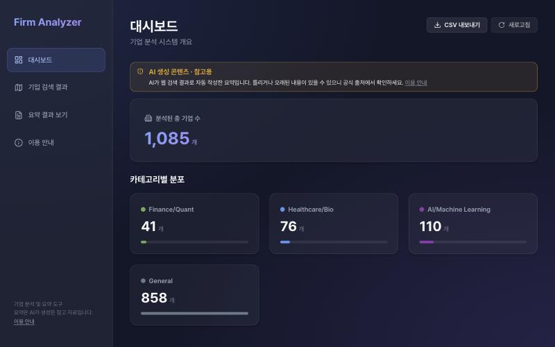
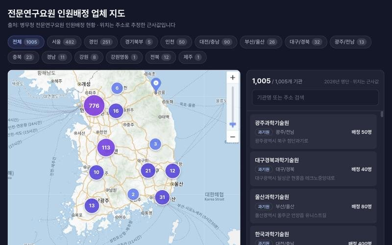
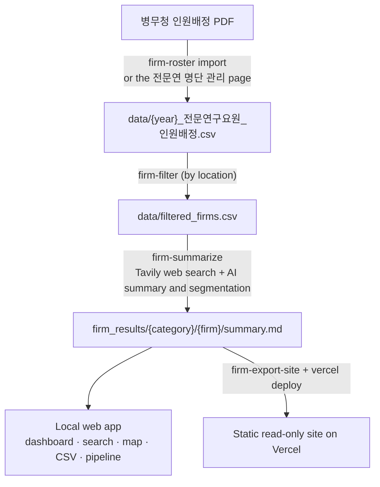

<div align="center">

# Firm Analyzer

**전문연구요원 지정업체 분석 도구**

Explore the firms on the Military Manpower Administration's yearly
전문연구요원 인원배정 list: search the web for each one, and let an AI summarize
and classify what it finds.

**English** · [한국어](README.ko.md)

[](https://firm-analyzer.vercel.app)


[](LICENSE)

**[Open the live demo →](https://firm-analyzer.vercel.app)**

</div>

> [!WARNING]
> **AI-generated, for reference only.** Firm summaries and classifications are
> written automatically by an AI model from public web search results. They can
> be wrong, outdated or mix up firms with similar names, and they are not
> statements by the companies. Check anything important with the company and
> the 병무청 (Military Manpower Administration). Full terms:
> [DISCLAIMER.md](DISCLAIMER.md).

<p align="center">
  
  
</p>

## Contents

- [Live demo](#live-demo)
- [How it works](#how-it-works)
- [Quick start](#quick-start)
- [Deploy your own copy](#deploy-your-own-copy)
- [Updating the 전문연 list](#updating-the-전문연-list)
- [Running the pipeline](#running-the-pipeline)
- [Configuration](#configuration)
- [Reference: commands and API](#reference-commands-and-api)
- [Data and privacy](#data-and-privacy)
- [Documentation](#documentation)
- [Development](#development) · [License](#license)

## Live demo

**<https://firm-analyzer.vercel.app>** is a read-only copy of the viewer, built
from this repository and hosted on Vercel. Nothing to install, no sign-in.

| | |
|---|---|
| **Status** | [](https://firm-analyzer.vercel.app) |
| **Published data** | AI summaries of 1,085 firms (mostly in Seoul), and a map of every firm on the 인원배정 list |
| **Last deployed** | 2026-11-14 |
| **How it updates** | By hand: the pipeline runs on the maintainer's machine, then a snapshot is uploaded (see [Deploy your own copy](#deploy-your-own-copy)). Pushing to GitHub does not redeploy it. |

### Using the site

| Page | What you can do |
|------|-----------------|
| **대시보드** (`/`) | See how many firms fall into each category. **CSV 내보내기** downloads every summarized firm as one CSV. |
| **인원배정 지도** (`/firms`) | Browse the whole 인원배정 list on a map, filter by region, or search by name or address. Positions are estimated from addresses, so they are approximate. |
| **요약 결과 보기** (`/summary`) | Search firm names and summary text, narrow by category, industry sector or technology vertical, then open a firm to read its summary and the sources it was built from. |
| **이용 안내** (`/about`) | What the AI-written content is, its limits, and how to ask for a correction. |

Searches are kept in the URL, so you can bookmark or share them, e.g.
[`/summary?q=반도체`](https://firm-analyzer.vercel.app/summary?q=%EB%B0%98%EB%8F%84%EC%B2%B4)
or [`/summary?category=ai_ml`](https://firm-analyzer.vercel.app/summary?category=ai_ml).

The hosted copy leaves out the pages that change files or spend API quota
(**전문연 명단 관리**, **파이프라인 실행**, **설정 변경**). Those run only in
the [local app](#quick-start).

> [!NOTE]
> If you represent a listed firm and want its summary corrected or removed,
> open an issue in this repository. The firm is taken out of the next deploy.

## How it works



- **Yearly list updates.** Upload the new 인원배정 PDF (or a CSV). The app
  extracts every row, checks the count against the last 연번, shows which firms
  are new and which dropped off, and switches the pipeline to the new list.
- **Choose your AI.** OpenAI, Claude, Gemini or GitHub Models. You only need a
  key for the one you use.
- **Multi-axis segmentation.** Sector, technology verticals, business model,
  value-chain position and organisation profile, each with a confidence level
  and an evidence sentence. The taxonomy is plain data in
  [`taxonomy.yml`](taxonomy.yml), explained in
  [docs/segmentation.md](docs/segmentation.md).
- **Traceable output.** Every summary carries the AI-generated notice and lists
  the search results it was built from.
- **Background jobs.** Filter, summarize and segment run as subprocesses with a
  live log, progress bar and cancel button.
- **Static publishing.** One command snapshots the read-only viewer so it can
  be hosted without a server.

## Quick start

You need Python 3.12+, [uv](https://docs.astral.sh/uv/), and Node.js 22+.

```bash
git clone https://github.com/<your-username>/firm_websearch.git   # your fork, or this repository
cd firm_websearch
uv sync                                     # Python dependencies
cp .env.example .env                        # then add your keys (below)
cd frontend && npm ci && npm run build && cd ..
uv run firm-app                             # http://localhost:8001
```

The minimum `.env` is a search key and the key for one AI provider:

```dotenv
TAVILY_API_KEY=...
LLM_PROVIDER=openai              # openai | claude | gemini | github
OPENAI_API_KEY=...               # or ANTHROPIC_API_KEY / GEMINI_API_KEY
```

Add `KAKAO_JS_API_KEY` to show the map. [`.env.example`](.env.example)
documents every variable. `.env` and `config.yml` are git-ignored; never commit
them.

> [!TIP]
> **Working on the frontend?** Run `uv run firm-app` in one terminal and
> `npm run dev` in `frontend/` in another, then open <http://localhost:5173>.
> The dev server forwards `/api` to Flask, so both share one origin.

> [!CAUTION]
> The server binds to `127.0.0.1`. The API has no authentication and can start
> jobs that spend your API quota, so only expose it (`FLASK_HOST`) on a network
> you trust. To share results publicly, publish the static copy instead.

## Deploy your own copy

The [live demo](#live-demo) is this codebase deployed as a static site. You can
publish your own copy, with your own data, the same way. Vercel only serves
files: every summary is generated on your machine, and no API key except the
Kakao JavaScript key ever leaves it.

**Before you start:** a [Vercel](https://vercel.com/) account (the free Hobby
plan is enough), the [Quick start](#quick-start) done, and summaries in
`firm_results/` from [the pipeline](#running-the-pipeline).

```bash
# 1. Generate data, if you haven't yet (needs TAVILY_API_KEY + one AI key)
uv run firm-filter
uv run firm-summarize --limit 10            # drop --limit for the whole list

# 2. Snapshot the read-only viewer into frontend/static-site/ (git-ignored)
uv run firm-export-site

# 3. Once: sign in and link the frontend folder to a new Vercel project
cd frontend
npx vercel login
npx vercel link
npx vercel pull --yes --environment=production

# 4. Each deploy: build on your machine, upload the result
npx vercel build --prod
npx vercel deploy --prebuilt --prod
```

Vercel prints the URL (`https://<project>.vercel.app`). For the map to load
there, `KAKAO_JS_API_KEY` must be in `.env` when you run `firm-export-site`, and
that URL must be in your Kakao app's allowed domains. The full guide, including
previewing locally and removing a firm, is
**[docs/VERCEL_DEPLOY.md](docs/VERCEL_DEPLOY.md)**
([한국어](docs/VERCEL_DEPLOY.ko.md)).

> [!IMPORTANT]
> Deploying makes every summary in your snapshot public. Keep the AI-generated
> notices, give companies a way to ask for corrections, and remove a firm when
> asked. See the operator duties in [DISCLAIMER.md](DISCLAIMER.md).

<details>
<summary><b>Why not "Import Git Repository" or a Deploy button?</b></summary>

`firm_results/` is never committed (it holds AI-written text about real
companies and scraped web pages), so a build on Vercel's servers would start
with no data. [`frontend/vercel.json`](frontend/vercel.json) therefore turns off
deploys from git pushes, and you build locally with `vercel build` and upload
with `--prebuilt`.

Any other static host works too: `npm run build:static` in `frontend/` writes a
plain static site to `frontend/dist/`. Serve `index.html` for paths that are not
files (the same rewrite as `vercel.json`) so that links like `/summary` load.

</details>

## Updating the 전문연 list

Each year the 병무청 publishes a new 「전문연구요원 인원배정 현황」 PDF.

**In the web UI:** open **전문연 명단 관리**, drop the PDF, check the year, and
press **가져오기**. You get:

- the new list saved as `data/<year>_전문연구요원_인원배정.csv`, with the PDF kept
  next to it as the source record;
- a warning if the number of rows does not match the last 연번, which means the
  table extraction missed or duplicated rows;
- a comparison with the previous list (firms added, removed, and how many
  stayed), each downloadable as CSV;
- the new list set as the pipeline's input (untick the option to keep the old
  one).

Then run **필터 후 요약** on the **파이프라인 실행** page. Firms that were
already summarized are skipped, so only the new firms cost API calls.

PDF extraction defaults to table recognition (pdfplumber: free, a few seconds).
For a scanned PDF without a text layer, choose **AI로 추출**, which sends the
pages to the selected AI provider.

**From the command line:**

```bash
uv run firm-roster import ~/Downloads/2027_전문연구요원_인원배정.pdf --year 2027
uv run firm-roster list                    # * marks the active list
uv run firm-roster compare 2026_전문연구요원_인원배정.csv 2027_전문연구요원_인원배정.csv --out-dir data/diff
uv run firm-roster activate 2026_전문연구요원_인원배정.csv   # switch back
uv run firm-roster import list.csv --year 2027 --overwrite  # a CSV (UTF-8 or CP949)
uv run firm-roster import scan.pdf --year 2027 --method llm --provider gemini
```

The active list is `data.roster` in `config.yml`. When it is unset, the newest
`<year>_전문연구요원_인원배정.csv` in `data/` is used. Firms are matched across
years by name, ignoring legal-form markers such as (주)/㈜/주식회사 and spacing,
so a firm whose lab was renamed shows up as one removal and one addition.

To refresh the map for the new list, regenerate its data with
`uv run --env-file .env firm-geocode`. The `--env-file` matters: the command
reads `KAKAO_REST_API_KEY` only from the environment, and without it every firm
gets approximate regional coordinates. See [docs/GEOCODING.md](docs/GEOCODING.md).

## Running the pipeline

The **파이프라인 실행** page runs each stage as a background job. From the
command line:

```bash
uv run firm-filter                                  # active list -> data/filtered_firms.csv
uv run firm-filter --locations 서울 경기            # override config.yml's location filter
uv run firm-summarize --dry-run                     # show the search queries only
uv run firm-summarize --limit 10                    # search, summarize and segment 10 firms
uv run firm-summarize --provider claude --limit 10
uv run firm-segment --dry-run                       # backfill segmentation for older summaries
uv run firm-export                                  # every firm -> firm_results/firms_export.csv
```

A firm that fails (bad model output, a search error) is skipped and reported;
only a rate-limit or quota error stops the run. Re-running retries exactly the
failed firms.

Each firm gets a folder in `firm_results/<category>/<firm>/`:

| File | Contents |
|------|----------|
| `summary.md` | Header, AI notice, segmentation table, summary, 출처 (sources) |
| `segmentation.json` | The structured classification |
| `raw_search.json` | The search response the summary was built from (scraped page text; keep it private) |
| `webpage.json` | The firm's official site, when found |

## Configuration

Settings live in `config.yml`, editable on the **설정 변경** page or by hand.
Start from the template, or let the app use its built-in defaults:

```bash
cp config.example.yml config.yml
```

| Section | What it controls |
|---------|------------------|
| `app.llm_provider`, `app.llm_models` | Which AI runs, and model overrides |
| `data.roster` | The active 인원배정 list (empty = newest year) |
| `filters.location` | Column, match type and values for the location filter |
| `categories` | Coarse buckets used for the output folders and dashboard |
| `search` | Tavily query template, depth, result count, extra context |
| `summary` | Language, focus areas, custom prompt, system prompt |
| `segmentation.enabled` | Classify against `taxonomy.yml` in the same call as the summary |

Custom prompts can change what a summary covers, but the content rules in
[`src/firm_analyzer/notice.py`](src/firm_analyzer/notice.py) (stick to the
sources, stay neutral, no unsupported negative claims, no personal data) are
always added to the system prompt.

## Reference: commands and API

<details>
<summary><b>Commands</b> (<code>uv run &lt;command&gt;</code>)</summary>

| Command | Purpose |
|---------|---------|
| `firm-app` | Web server (API, built frontend, map) |
| `firm-roster` | Import, list, compare and activate 인원배정 lists |
| `firm-filter` | Location filter over the active list |
| `firm-summarize` | Search, summarize and segment |
| `firm-segment` | Segment firms summarized before segmentation existed |
| `firm-export` | Rebuild one CSV from the result folders |
| `firm-export-site` | Snapshot the read-only viewer as static files for Vercel |
| `firm-geocode` | Regenerate the map data from the active list |
| `firm-parse-pdf` | Generic rule-based PDF table → CSV |
| `firm-parse-pdf-llm` | Generic AI PDF → CSV |
| `firm-supabase-sync` | Upload results to Supabase |
| `firm-find-webpage` | Find one firm's official website |

Every command also runs as `uv run python scripts/run_<name>.py` from a
checkout. More detail per engine: [docs/ENGINES_GUIDE.md](docs/ENGINES_GUIDE.md).

</details>

<details>
<summary><b>HTTP API</b> (local server only)</summary>

| Endpoint | Method | Description |
|----------|--------|-------------|
| `/api/config` | GET, POST | Read or save `config.yml` |
| `/api/config/reset` | POST | Restore the default configuration |
| `/api/rosters` | GET | Lists in `data/` and the active one |
| `/api/rosters/import` | POST | Multipart `file` (PDF/CSV), `year`, `method` (`rule`/`llm`), `provider`, `activate`, `overwrite` |
| `/api/rosters/active` | POST | `{"name": "<csv>"}`: make a list the filter's input (409 while a job runs) |
| `/api/rosters/compare` | GET | `?base=&target=`: firms added, removed and kept |
| `/api/rosters/compare.csv` | GET | Same, one side (`part=added\|removed`) as CSV |
| `/api/rosters/<name>/download` | GET | Download a list |
| `/api/results/summary` | GET | Firm counts per category |
| `/api/results/<category_id>` | GET | Firms in a category with full summaries |
| `/api/firms` | GET | Search across categories: `q`, `category`, `sector`, `vertical`, `business_model`, `confidence`, `segmented` |
| `/api/firms/<category_id>/<firm_name>` | GET | One firm's `summary.md` and segmentation |
| `/api/taxonomy` | GET | The segmentation taxonomy |
| `/api/export.csv` | GET | Every firm as one CSV, each row labelled AI-generated |
| `/api/llm/providers` | GET | Providers, whether each has a key, and the active one |
| `/api/jobs` | GET, POST | List jobs, or start one: `{"kind": "filter"\|"summarize"\|"segment"\|"pipeline", "options": {...}}` |
| `/api/jobs/<id>?since=<n>` | GET | Status, progress and new log lines |
| `/api/jobs/<id>/cancel` | POST | Stop a running job |
| `/map` | GET | Map of the list's firms (Kakao Maps) |

One job runs at a time, because every stage writes the same files. Jobs live in
server memory and stop when the server exits.

</details>

## Data and privacy

- **Committed:** the public 병무청 인원배정 PDFs and their CSV conversions in
  `data/`, sample CSVs in `data/samples/`, and the map's coordinates
  (`firms_data.js`). These are public lists of designated organisations.
- **Never committed:** `firm_results/` (AI-written text about real companies and
  scraped web pages), `.env`, `config.yml`, caches. They are in `.gitignore`.
- **Static site:** `firm-export-site` writes summaries, segmentation, the CSV
  and the map to `frontend/static-site/` (git-ignored). Deploying it publishes
  them. Scraped pages and every key except the Kakao JavaScript key are never
  written.
- **Kakao:** `KAKAO_JS_API_KEY` is sent to the browser, so restrict it to your
  domains in the Kakao console. `KAKAO_REST_API_KEY` stays on the server.
- **Supabase:** `firm-supabase-sync` uploads summaries with the AI notice and
  leaves out `raw_search.json` unless you pass `--include-raw-search`. The anon
  key is public by design, so enable Row Level Security before exposing the
  table. See [docs/SUPABASE_SETUP.md](docs/SUPABASE_SETUP.md).

## Documentation

| Guide | Covers |
|-------|--------|
| [Deploying to Vercel](docs/VERCEL_DEPLOY.md) · [한국어](docs/VERCEL_DEPLOY.ko.md) | Publishing the read-only viewer |
| [Engines guide](docs/ENGINES_GUIDE.md) | Every CLI engine, in English and Korean |
| [Segmentation method](docs/segmentation.md) | The five classification axes and how firms are told apart |
| [Firm data format](docs/FIRM_DATA_FORMAT.md) | Using your own CSV of firms |
| [Geocoding](docs/GEOCODING.md) · [Kakao Maps setup](docs/KOREAN_MAPS_SETUP.md) | Map coordinates and the Kakao keys |
| [Supabase](docs/SUPABASE_SETUP.md) | Syncing results to a database |
| [PDF parser](docs/README_PDF_PARSER.md) · [Webpage finder](docs/README_WEBPAGE_FINDER.md) | Standalone tools |
| [Frontend](frontend/README.md) · [Tests](tests/README.md) | Working on the code |

## Project layout

```
src/firm_analyzer/
  core/        filter, summarize, roster (명단), segmentation, export, parsers, geocoding
  llm/         one interface over OpenAI, Claude, Gemini and GitHub Models
  web/         Flask API, job runner, static-site export, map template
  notice.py    the AI-generated notice and prompt content rules
frontend/      React + TypeScript web interface (Vite), and the Vercel config
data/          인원배정 lists (PDF + CSV) and samples
docs/          guides for each engine, the data format, geocoding, deployment
tests/         pytest suite
taxonomy.yml   the segmentation taxonomy
```

## Development

```bash
uv sync --extra dev && uv run pytest tests/ -q
cd frontend && npx tsc -b && npm run lint && npm run build
```

CI runs both, builds the wheel, and fails if a `.env` or a credential-shaped
string is committed.

## License

MIT, see [LICENSE](LICENSE). The software and its output come with no warranty;
see [DISCLAIMER.md](DISCLAIMER.md).
